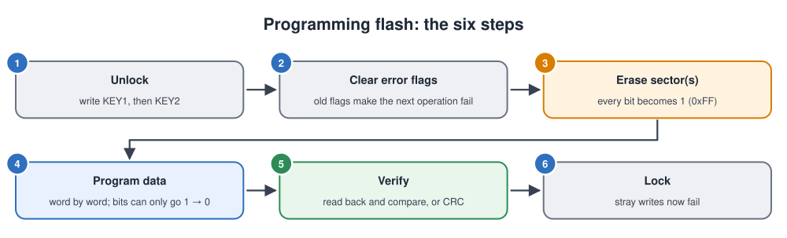

# Bootloader: Interview Study Notes

## Contents

| # | Section |
| --- | --- |
| – | [Abbreviations](#abbreviations) |
| 1 | [What is a bootloader?](#1-what-is-a-bootloader) |
| 2 | [What happens after reset](#2-what-happens-after-reset) |
| 3 | [Memory map and linker scripts](#3-memory-map-and-linker-scripts) |
| 4 | [Jumping to the application](#4-jumping-to-the-application) |
| 5 | [Flash programming](#5-flash-programming) |
| 6 | [Entering update mode and the update protocol](#6-entering-update-mode-and-the-update-protocol) |
| 7 | [Image validation](#7-image-validation) |
| 8 | [Fail-safe updates: A/B and rollback](#8-fail-safe-updates-ab-and-rollback) |
| 9 | [Secure boot](#9-secure-boot) |
| 10 | [OTA updates, end to end](#10-ota-updates-end-to-end) |
| 11 | [Real-world bootloaders: STM32, ESP32, MCUboot](#11-real-world-bootloaders-stm32-esp32-mcuboot) |
| 12 | [STM32 example 1: a bootloader, step by step](#12-stm32-example-1-a-bootloader-step-by-step) |
| 13 | [STM32 example 2: a two-stage bootloader](#13-stm32-example-2-a-two-stage-bootloader) |
| 14 | [Linux boot flow and U-Boot](#14-linux-boot-flow-and-u-boot) |
| 15 | [Debugging bootloaders](#15-debugging-bootloaders) |
| 16 | [Interview drill](#16-interview-drill) |
| 17 | [Frequently asked bootloader interview questions](#17-frequently-asked-bootloader-interview-questions) |

---

## Abbreviations

| Short | Full form | Short | Full form | Short | Full form |
| --- | --- | --- | --- | --- | --- |
| **ACK / NACK** | Acknowledge / Negative Acknowledge | **GDB** | GNU Debugger | **ROM** | Read-Only Memory |
| **AES** | Advanced Encryption Standard | **GPIO** | General-Purpose Input/Output | **RSA** | Rivest-Shamir-Adleman |
| **AIRCR** | Application Interrupt and Reset Control Register | **HAL** | Hardware Abstraction Layer | **RTOS** | Real-Time Operating System |
| **AN** | Application Note (e.g. ST AN2606) | **HFSR** | HardFault Status Register | **SCB** | System Control Block (Cortex-M) |
| **BFAR** | BusFault Address Register | **HMAC** | Hash-based Message Authentication Code | **SD** | Secure Digital |
| **BLE** | Bluetooth Low Energy | **HSI** | High-Speed Internal (oscillator) | **SHA-256** | Secure Hash Algorithm, 256-bit |
| **CBC / CTR / GCM / ECB** | Cipher Block Chaining / Counter / Galois/Counter Mode / Electronic Codebook | **HSM** | Hardware Security Module | **SOF** | Start Of Frame |
| **CFSR** | Configurable Fault Status Register | **HTTP / HTTPS** | Hypertext Transfer Protocol / HTTP Secure | **SP** | Stack Pointer |
| **CMSIS** | Common Microcontroller Software Interface Standard | **IAP / ISP** | In-Application / In-System Programming | **SPI** | Serial Peripheral Interface |
| **CPU** | Central Processing Unit | **IRQ / ISR** | Interrupt Request / Interrupt Service Routine | **SPL** | Secondary Program Loader |
| **CRC** | Cyclic Redundancy Check | **KMS** | Key Management Service | **STAR** | Situation, Task, Action, Result |
| **DFU** | Device Firmware Upgrade | **MMU / MPU** | Memory Management Unit / Memory Protection Unit | **SWD** | Serial Wire Debug |
| **DMA** | Direct Memory Access | **MSP / PSP** | Main / Process Stack Pointer | **TF-A / TF-M** | Trusted Firmware-A / Trusted Firmware-M |
| **DRAM** | Dynamic Random Access Memory | **NAND / NOR** | Two types of flash memory | **TLS** | Transport Layer Security |
| **DSB / ISB** | Data / Instruction Synchronization Barrier | **NMI** | Non-Maskable Interrupt | **UART** | Universal Asynchronous Receiver-Transmitter |
| **DTB** | Device Tree Blob | **NVIC** | Nested Vectored Interrupt Controller | **URL** | Uniform Resource Locator (a web address) |
| **ECC** | Error-Correcting Code | **OP-TEE** | Open Portable Trusted Execution Environment | **USB** | Universal Serial Bus |
| **ECDSA** | Elliptic Curve Digital Signature Algorithm | **OTA** | Over-The-Air | **VTOR** | Vector Table Offset Register |
| **eFuse** | Electronic fuse | **OTP** | One-Time Programmable | **WRP** | Write Protection |
| **ELF** | Executable and Linkable Format | **PC** | Program Counter (or Personal Computer) | **XIP** | Execute In Place |
| **eMMC** | embedded MultiMediaCard | **PMIC** | Power Management Integrated Circuit | **XOR** | Exclusive OR |
| **FIT** | Flattened Image Tree | **RAM / SRAM** | Random Access Memory / Static RAM |  |  |
| **FPU** | Floating-Point Unit | **RDP** | Readout Protection |  |  |

---

## 1. What is a bootloader?

> A **bootloader** is a **small program that runs first after reset**. It checks that the application is valid, can **update** it, and then **jumps** to it.


**Its five jobs:**

1. **Minimal init:** clock, flash, one UART or GPIO. The app sets up the rest.
2. **Decide:** stay in update mode, or start the app?
3. **Validate:** is the app complete (CRC), and made by us (signature)?
4. **Update:** receive, erase, write, verify.
5. **Hand over:** clean up and jump to the app.

| | Boot ROM | Your bootloader |
| --- | --- | --- |
| Written by | Chip vendor | You |
| Stored in | ROM inside the chip | Flash |
| Can change? | Never | Yes, carefully |
| Example | STM32 system memory, ESP32 ROM | Custom UART bootloader, MCUboot, U-Boot |

**The Boot ROM is not a stage of your bootloader.** It's the chip vendor's fixed code that runs **before** it. The first and second stages are **both written by you and stored in flash**:

| Design | What runs after the Boot ROM | Example |
| --- | --- | --- |
| **Single-stage** | One bootloader (in flash) → application | A custom STM32 UART bootloader |
| **Two-stage** | **First stage** (small, never updated, in flash) → **second stage** (full features, updatable, in flash) → application | Nordic NSIB → MCUboot; the STM32 example in [section 13](#13-stm32-example-2-a-two-stage-bootloader) |
| **Linux board** | First stage **SPL** (sets up DRAM) → second stage **U-Boot** → Linux kernel | [Section 14](#14-linux-boot-flow-and-u-boot) |

> **Naming trap:** some vendors count their ROM as "stage 1". Espressif calls the ESP-IDF bootloader the "second-stage bootloader" for that reason, although it's the only bootloader you write. In an interview, say what runs, from where, and who wrote it.

### Interview questions: what a bootloader is

**Q: What is a bootloader, and why do we need one?**
**A:** A bootloader is a small program that runs first after reset. It checks the application is valid, can update it, and then jumps to it. We need it to update firmware in the field without a debugger, to recover from corrupted firmware, and, with secure boot, to run only our signed code. I keep it small and write-protected, because if the bootloader breaks, the device is bricked.

**Q: Boot ROM vs bootloader?**
**A:** The Boot ROM is written by the chip vendor, sits in ROM and can never change. My bootloader sits in flash and implements our own update and security rules.

**Q: What are first-stage and second-stage bootloaders?**
**A:** Both are our own code in flash, running after the chip's Boot ROM. The first stage is small and never changes; it only checks the second stage and starts it, or on Linux boards it sets up DRAM. The second stage has the real features: updates, validation, loading the application. Splitting it lets me update the second stage safely, or fit a big bootloader that needs DRAM. The Boot ROM itself isn't a stage of our bootloader; it's the vendor's fixed code that starts the first one.

**Q: Why keep the bootloader small?**
**A:** It usually can't be updated, so every bug in it stays in the field forever. I put only what's needed in it and leave everything else to the app.

---

## 2. What happens after reset

> At reset the CPU reads **word 0** of the vector table into **MSP** and **word 1** (the `Reset_Handler` address) into the **PC**. `Reset_Handler` then sets up memory and calls `main()`.

![From power-on to main() in 8 steps: 1, a reset source (power-on, reset pin, watchdog or software reset), the CPU held until power is stable; 2, the boot pins are sampled and BOOT0 decides what appears at address 0x0000_0000; 3, the CPU reads word 0 into the Main Stack Pointer; 4, it reads word 1 into the PC, the Reset_Handler address; 5, Reset_Handler sets SP again and calls SystemInit() for the clock and FPU; 6, copy .data from flash to RAM; 7, zero .bss; 8, __libc_init_array() then main(), which never returns. Steps 1 to 4 are done by the hardware, steps 5 to 8 by the startup code](images/reset_to_main.svg)

**Done by the hardware:**

1. **Reset:** power-on, reset pin, watchdog, software reset or brown-out. The CPU starts in privileged mode, using MSP, on the internal HSI clock, with VTOR = 0 and every peripheral interrupt off.
2. **Boot pins:** BOOT0 = 0 maps main flash (`0x0800_0000`) at address `0x0000_0000`. (BOOT0 = 1 maps ST's ROM bootloader instead.)
3. **MSP = word 0** (address `0x0000_0000`): the top of RAM, e.g. `0x2002_0000`. The stack comes first so it exists before any code runs.
4. **PC = word 1** (address `0x0000_0004`): the address of `Reset_Handler`, e.g. `0x0800_01C1`. Bit 0 = 1 is the **Thumb bit**; the CPU clears it and jumps to `0x0800_01C0`.

**Done by the startup code (`Reset_Handler` in `startup_stm32xxxx.s`):**

5. Set SP again (`ldr sp, =_estack`), then call `SystemInit()`: basic clock and FPU setup.
6. **Copy `.data`** from flash to RAM (initial values of globals like `int x = 5;`).
7. **Zero `.bss`** (globals with no value, like `int total;`).
8. Run C++ constructors (`__libc_init_array`), then call **`main()`**, which never returns.

### Where word 0 and word 1 come from

![Where word 0 and word 1 come from: 1, the linker script sets _estack to ORIGIN(RAM) + LENGTH(RAM), 0x20000000 + 128 KB = 0x20020000, and places the .isr_vector section first in FLASH; 2, the startup file defines g_pfnVectors as .word _estack, .word Reset_Handler, .word NMI_Handler, .word HardFault_Handler and so on; 3, after linking, flash at 0x0800_0000 holds 0x2002_0000, then 0x0800_01C1 (Reset_Handler at 0x0800_01C0 plus the Thumb bit), then the other handlers; 4, at reset the CPU sets MSP to word 0 and PC to word 1 without its Thumb bit, and Reset_Handler runs](images/vector_table_from_linker.svg)

1. The **linker script** defines `_estack = ORIGIN(RAM) + LENGTH(RAM)` (top of RAM) and puts the `.isr_vector` section **first** in flash, with `KEEP` so it's never removed.
2. The **startup file** fills that section: `.word _estack`, then `.word Reset_Handler`, then the other handlers.
3. So the first two words of flash are the stack top and the reset handler address, exactly what the CPU reads at reset.

### The Cortex-M vector table

![The Cortex-M vector table, what is at each address: offset 0x0000 holds the initial SP value, read into MSP at reset; 0x0004 the Reset handler, read into the PC; then the faults and NMI, fixed by Arm: NMI at 0x0008 (exception 2), HardFault at 0x000C (3), MemManage at 0x0010 (4), BusFault at 0x0014 (5), UsageFault at 0x0018 (6); reserved entries 7 to 10; then the system exceptions: SVCall at 0x002C (11), Debug monitor at 0x0030 (12), reserved 13, PendSV at 0x0038 (14), SysTick at 0x003C (15); then the peripheral interrupts defined by the chip maker from IRQ0 at 0x0040 (exception 16) up to IRQn at 0x0040 + 4n. Offset = exception number × 4; IRQ number = exception number − 16. The table starts at the address in VTOR](images/cortexm_vector_table.svg)

1. It's an **array of 32-bit addresses** that starts at the address in **VTOR**. At reset VTOR is `0x0000_0000`, which on STM32 is the start of flash.
2. **Word 0 is the initial stack pointer**, not a handler. **Word 1 is the Reset handler.** These are the two words the hardware reads at reset.
3. **Words 1-15 are the system exceptions**, the same on every Cortex-M: Reset, NMI, the faults, SVCall, PendSV and SysTick.
4. **From word 16 on are the peripheral interrupts (IRQs)**, defined by the chip maker. An STM32F4 has 82, so its table has 16 + 82 = 98 entries (392 bytes, aligned to 0x200).
5. **Offset = exception number × 4**, and **IRQ number = exception number − 16**. CMSIS uses the IRQ number, so system exceptions are negative (for example `SysTick_IRQn = -1`).
6. **When an interrupt fires**, the CPU reads the handler address at **VTOR + 4 × exception number** and jumps there. Example: USART1 on an STM32F4 is IRQ 37, so exception 53, at offset 53 × 4 = `0xD4`.

### Interview questions: reset

**Q: What happens when a Cortex-M comes out of reset?**
**A:** The boot pins are sampled; on STM32, BOOT0 low maps main flash at address 0. The hardware then loads word 0 of the vector table into MSP and word 1, the reset handler address with the Thumb bit set, into the PC. `Reset_Handler` sets the stack pointer, calls `SystemInit`, copies `.data` from flash to RAM, zeroes `.bss`, runs the constructors and calls `main`.

**Q: What is in the Cortex-M vector table?**
**A:** An array of 32-bit addresses at the start of the program. Word 0 is the initial stack pointer and word 1 the reset handler; words 2 to 15 are the system exceptions like NMI, HardFault and SysTick; from word 16 on are the chip's peripheral interrupts. The CPU finds it through VTOR.

**Q: How does the CPU find the handler for an interrupt?**
**A:** It reads the address at VTOR plus 4 times the exception number, and jumps there. For example USART1 on an STM32F4 is IRQ 37, which is exception 53, so its handler address is at offset 0xD4.

**Q: What's the difference between the exception number and the IRQ number?**
**A:** The exception number counts every entry in the table, starting at 1 for Reset. The IRQ number is what CMSIS uses: exception number minus 16, so peripheral interrupts start at IRQ 0 and system exceptions are negative, like SysTick at −1.

**Q: Where does the initial MSP value come from?**
**A:** From the linker script: `_estack` is the top of RAM. The startup file puts it as word 0 of the vector table, and the linker places the vector table first in flash, so the CPU reads it at reset.

**Q: Why is the stack pointer the first entry?**
**A:** So a valid stack exists before the first instruction; `Reset_Handler` calls C code and a fault could happen immediately.

**Q: Why are handler addresses odd?**
**A:** Bit 0 is the Thumb bit. Cortex-M only runs Thumb code, so it must be 1; an even address causes a fault.

**Q: Is `main()` the first code that runs?**
**A:** No. `Reset_Handler` and `SystemInit` run first, and `.data` and `.bss` are set up before `main` is called.

---

## 3. Memory map and linker scripts

> The bootloader and the app are **two separate programs** in one flash. Each has its **own linker script**, and every boundary must be on a **flash sector boundary**, because flash is erased by whole sectors.

![The memory map sector by sector, STM32F411: sectors 0 to 2 (16 KB = 0x4000 each) hold the bootloader, 3 × 16 = 48 KB = 0xC000, from 0x0800_0000 to 0x0800_C000, write-protected; sector 3 (16 KB) holds the metadata from 0x0800_C000; sectors 4 (64 KB = 0x1_0000) and 5 to 7 (128 KB = 0x2_0000 each) hold the application, 64 + 3 × 128 = 448 KB = 0x7_0000, from 0x0801_0000 to 0x0808_0000. The rule: the next start address is this start address plus this size in hex; 1 KB = 0x400. RAM is 128 KB = 0x2_0000: a 32-byte NOINIT area at 0x2000_0000, then the rest from 0x2000_0020 up to 0x2002_0000, which is _estack](images/memory_map_math.svg)

**How the addresses are calculated:** next start = start + size, with 1 KB = `0x400`.

| Region | Size | Start → end |
| --- | --- | --- |
| Bootloader (sectors 0-2) | 3 × 16 KB = 48 KB = `0xC000` | `0x0800_0000` → `0x0800_C000` |
| Metadata (sector 3) | 16 KB = `0x4000` | `0x0800_C000` → `0x0801_0000` |
| Application (sectors 4-7) | 64 + 3 × 128 = 448 KB = `0x7_0000` | `0x0801_0000` → `0x0808_0000` |

**The steps:**

1. **Bootloader linker script:** `FLASH ORIGIN = 0x08000000, LENGTH = 48K`.
2. **App linker script:** `FLASH ORIGIN = 0x08010000, LENGTH = 448K`. The linker fails with "region FLASH overflowed" if either program is too big.
3. **The app sets VTOR** to its own vector table: `SCB->VTOR = 0x08010000;` (or `VECT_TAB_OFFSET = 0x10000` in `SystemInit`).
4. **Alignment:** the vector table must be aligned to its size rounded up to a power of 2, typically **0x200**. `0x0801_0000` is fine.
5. **App → bootloader messages** ("enter update mode") use a **magic word in a `.noinit` RAM variable** (not zeroed at startup), then `NVIC_SystemReset()`:

```c
__attribute__((section(".noinit"))) volatile uint32_t g_boot_request;   /* in both projects */

g_boot_request = 0xB00710ADu;      /* APP: ask for an update */
NVIC_SystemReset();

if (g_boot_request == 0xB00710ADu) { g_boot_request = 0; enter_update_mode(); }   /* BOOTLOADER */
```

### Interview questions: the memory map

**Q: How do you split flash between the bootloader and the application?**
**A:** I start from the sector layout, because erase size decides everything. The bootloader gets the first sectors and is write-protected, a small sector holds metadata, and the rest is the app. Each program has its own linker script with matching `ORIGIN` and `LENGTH`, and the app sets VTOR to its own vector table.

**Q: Why must the boundary be on a sector boundary?**
**A:** Flash is erased by whole sectors. If both programs shared one, updating the app would erase part of the bootloader.

**Q: How does the app tell the bootloader to enter update mode?**
**A:** It writes a 32-bit magic value into a `.noinit` RAM variable and resets. The bootloader checks it first, clears it and stays in update mode. I use 32 bits, not a bool, because random RAM after power-on could easily look like `true`.

---

## 4. Jumping to the application

> The jump is **a manual reset**: clean up, set **VTOR** to the app's vector table, load **MSP** from its word 0, and branch to its **word 1**. This is the **most-asked coding question**.

![The jump to the application, step by step: 1, is the app valid (MSP in RAM, reset vector inside the app, CRC or signature OK; if not, stay in the bootloader); 2, de-initialise the peripherals the bootloader used; 3, clocks back to reset state; 4, disable interrupts; 5, stop SysTick, which the NVIC doesn't control; 6, disable every NVIC IRQ and clear every pending bit; 7, set SCB->VTOR to the app address; 8, set MSP from the app's word 0; 9, DSB and ISB; 10, branch to the app's word 1, its Reset_Handler](images/jump_sequence.svg)

```c
#define APP_ADDRESS  0x08010000u

void jump_to_application(void)
{
    uint32_t app_sp    = *(volatile uint32_t *)(APP_ADDRESS);       /* word 0 */
    uint32_t app_reset = *(volatile uint32_t *)(APP_ADDRESS + 4);   /* word 1 */

    if (app_sp < 0x20000000u || app_sp > 0x20020000u) return;       /* 1. valid? (erased = 0xFFFFFFFF) */

    HAL_UART_DeInit(&huart1);                    /* 2. undo what the bootloader set up */
    HAL_RCC_DeInit();                            /* 3. clocks back to reset state      */
    __disable_irq();                             /* 4. no interrupts during the switch */
    SysTick->CTRL = 0;                           /* 5. SysTick isn't in the NVIC       */
    for (int i = 0; i < 8; i++) {                /* 6. every IRQ off, nothing pending  */
        NVIC->ICER[i] = 0xFFFFFFFFu;
        NVIC->ICPR[i] = 0xFFFFFFFFu;
    }
    SCB->VTOR = APP_ADDRESS;                     /* 7. the app's vector table */
    __set_MSP(app_sp);                           /* 8. the app's stack        */
    __DSB(); __ISB();                            /* 9. make it take effect    */
    __enable_irq();
    ((void (*)(void))app_reset)();               /* 10. the app's Reset_Handler */
}
```

**Key points:**

1. **Read both words first:** after `__set_MSP()` the stack has moved, so old local variables are unreliable.
2. **Branch to word 1, not to `APP_ADDRESS`:** word 0 is the stack value, not code.
3. **Cleanest option, "jump through reset":** set a magic word in `.noinit` RAM, reset, and jump at the very start of `main()` before initialising anything. The hardware is then really clean.

### Interview questions: the jump

**Q: Write the code to jump to the application.** *(Write the code above, then say:)*
**A:** First I check the app's word 0 is a RAM address and word 1 is inside the app, and that the CRC passes. I de-init the peripherals and clocks, disable interrupts, stop SysTick because the NVIC doesn't control it, and clear all NVIC enable and pending bits. I set VTOR to the app's table, load MSP from word 0, do DSB and ISB, and branch to word 1. I read both words before changing MSP, because changing MSP moves the stack.

**Q: Why `APP_ADDRESS + 4`?**
**A:** Word 0 is the initial stack pointer, which is data. Word 1 is the address of the app's `Reset_Handler`, so I branch to that value.

**Q: What if VTOR isn't updated?**
**A:** The app runs until its first interrupt; then the CPU uses the bootloader's handler, usually a HardFault.

**Q: Why stop SysTick separately?**
**A:** SysTick is a core exception, not an NVIC interrupt, so clearing the NVIC doesn't stop it. If it keeps running, the app gets a tick before it's ready.

**Q: The app works when flashed alone but crashes after the bootloader jumps. Why?**
**A:** Usually VTOR not set, SysTick or a peripheral or DMA left running, or the app linked for `0x0800_0000` instead of its slot. I break on the app's `Reset_Handler` in the debugger and check VTOR, MSP and SysTick.

---

## 5. Flash programming

> Writing flash can only change bits **1 → 0**. Only an **erase of a whole sector** sets them back to 1 (0xFF). So every write is **unlock → erase → write → verify → lock**.



```c
HAL_FLASH_Unlock();                                         /* KEY1 0x45670123, KEY2 0xCDEF89AB */
HAL_FLASHEx_Erase(&erase_sectors_4_to_7, &bad_sector);      /* all bits → 1 (0xFF)              */
HAL_FLASH_Program(FLASH_TYPEPROGRAM_WORD, addr, word);      /* bits 1 → 0, one word at a time   */
HAL_FLASH_Lock();
if (memcmp((void *)addr, data, len) != 0) { /* verify failed */ }
```

**Key points:**

1. **Writing without erasing** gives the AND of old and new data (0xA5 then 0x5A → 0x00).
2. **ECC flash** (STM32L4, G4, H7) allows each double-word to be written **only once** after an erase.
3. **The CPU stalls during an erase** on a single-bank chip (up to 1-2 s for 128 KB), because it fetches code from the same flash. UART bytes are lost and the watchdog may fire. Fix: erase before the transfer, refresh the watchdog between sectors, or run the code from RAM.
4. **Protect the bootloader:** **WRP** blocks erasing and writing its sectors; **RDP** blocks reading from outside (level 2 is permanent). Also range-check every address the host sends.

### Interview questions: flash

**Q: Why must flash be erased before writing?**
**A:** Programming only changes bits from 1 to 0; an erase sets a whole sector back to all 1s. Writing over old data gives the AND of old and new, and on ECC flash each unit can only be programmed once after an erase.

**Q: Your bootloader loses UART data during an erase. Why?**
**A:** On a single-bank part the CPU stalls while fetching code from the flash that's erasing, so the UART interrupt is late and the receiver overruns. I erase before the transfer and make the host wait for an ACK, or run the code from RAM.

**Q: How do you protect the bootloader from being overwritten?**
**A:** Write protection on its sectors, a range check on every write address, and readout protection in production.

---

## 6. Entering update mode and the update protocol

> The bootloader needs **a reason to stay** (button, magic word, broken app) and a **reliable packet protocol** to receive the new image.


**Always keep one way in that works when the app is broken:** a button, the invalid-app check, or a boot counter.

**The packet:**

```text
| SOF 0xA5 | CMD | SEQ | LEN (2 B) | PAYLOAD (0-256 B) | CRC16 |
```

**The update, step by step:**

1. **START** (size, version, image CRC): check the size, **mark the app invalid**, erase, ACK.
2. **DATA** (offset + bytes) for each chunk: check the CRC16 and sequence number, range-check the address, write, read back, ACK. A bad packet gets a NACK and is resent.
3. **END:** check the CRC-32 of the whole image, then **mark the app valid**, ACK.
4. **BOOT:** reset into the new app.

**Invalidate first, validate last:** any interruption in between leaves a clearly invalid app, never a half-written one that looks valid.

### Interview questions: the update protocol

**Q: Design a UART bootloader protocol.**
**A:** Framed packets with a start byte, command, sequence number, length, payload and CRC16, and an ACK or NACK for each one. At start I mark the app invalid and erase; each data packet is checked, range-checked, written and read back; at the end I check the whole-image CRC and only then mark the app valid. Duplicates are ACKed without writing, and timeouts abort a stalled transfer.

**Q: Why a sequence number if there's a CRC?**
**A:** The CRC catches corrupted bytes; the sequence number catches missing or duplicated packets.

**Q: The host resends a packet because it missed our ACK. What do you do?**
**A:** I see it's the one I just handled, so I ACK it again without writing; writing twice could corrupt data or fault on ECC flash.

---

## 7. Image validation

> Two different questions: **"Is it complete?"** (CRC) and **"Did we make it?"** (signature).

| Tool | Catches accidents | Catches attackers | Proves who made it |
| --- | --- | --- | --- |
| Checksum | Some | No | No |
| **CRC-32** | **Yes** (every burst up to 32 bits) | No: anyone can recompute it | No |
| SHA-256 | Yes | Only if the expected hash is trusted | No |
| **Signature** (ECDSA / RSA) | Yes | **Yes** | **Yes** |

**What the bootloader checks, in order:**

1. **Magic number:** is there an image at all?
2. **Size:** is it within the slot? (Check it before using it.)
3. **Vector table:** word 0 in RAM, word 1 inside the app with the Thumb bit.
4. **CRC-32** over the image = the value stored in its header.
5. **Signature**, for secure boot ([section 9](#9-secure-boot)).

Check **at every boot**, not just after a download: flash bits can flip. CRC-32 test value: `crc32("123456789") = 0xCBF43926`.

### Interview questions: validation

**Q: Checksum vs CRC vs hash vs signature?**
**A:** A checksum just adds bytes and misses swapped bytes. A CRC reliably catches accidental errors but anyone can recompute it, so it's no security. A hash like SHA-256 is secure only if the expected hash comes from a trusted source. A signature is the hash signed with our private key and checked with the public key in the device, so it proves the image is intact and that we made it. CRC for accidents, signatures for attackers.

**Q: Can CRC be used for secure boot?**
**A:** No. It has no secret: an attacker changes the image and recomputes the CRC.

**Q: The bootloader's CRC doesn't match my Python script's. Why?**
**A:** Different CRC variants: the STM32F4 hardware unit works on 32-bit words with no reflection and no final XOR, unlike Python's `zlib.crc32`. I use one variant on both sides and test with "123456789".

---

## 8. Fail-safe updates: A/B and rollback

> **Never erase the only working image until the new one has proven itself.** Every step must survive a power loss, and a bad new image must **roll back**.

| Strategy | How | Rollback? |
| --- | --- | --- |
| Single slot | Erase the app, write the new one in place | No; if it fails, wait in the bootloader |
| Download slot + copy | Download into a 2nd slot (often external flash), then the bootloader copies it in | No |
| **A/B slots** | Two full slots; update the inactive one, switch after it proves itself | **Yes, instant** |
| Swap (MCUboot) | Swap the two slots sector by sector | Yes (swap back) |

![The update state machine: 1, the app starts an OTA download, from IDLE to DOWNLOADING; 2, the image is verified and 'try the new slot' is written, PENDING; 3, the bootloader boots the new slot once, TESTING, attempts++; 4, the self-test passes and the app writes CONFIRMED; 5, a reset before confirming, from a crash, the watchdog or too many attempts, leads to ROLLBACK; 6, the old slot is booted again and the new one marked INVALID; 7, a failed download or verification returns to IDLE; 8, after CONFIRMED, wait for the next update](images/update_state_machine.svg)

**An A/B update, step by step:**

1. The app (running from slot A) downloads the new image into slot B and verifies it.
2. It writes **"pending = B"** into the metadata and resets.
3. The bootloader verifies B, sets **TESTING**, starts the **watchdog**, and boots B.
4. B runs a **self-test** (peripherals, network, **update server reachable**), then writes **CONFIRMED**.
5. If B crashes or hangs, the watchdog resets; after too many boot attempts without CONFIRMED, the bootloader **rolls back** to A.

**Power-safe metadata:** keep **two copies**, each with a **sequence number** and a **CRC**. Use the valid copy with the highest sequence number, and always write the older copy. A power cut damages only the copy being written.

**A/B catch:** an image linked for slot A's address won't run from slot B, so build once per slot, or use a dual-bank chip's bank swap.

### Interview questions: fail-safe updates

**Q: How do you make OTA updates fail-safe?**
**A:** I never erase the working image until the new one has proven itself. The app downloads into the inactive slot, verifies it, writes "pending" into power-safe metadata with two copies, and resets. The bootloader verifies it again and boots it in a test state with a boot counter and the watchdog on. The new app runs a self-test, including reaching the update server, and only then confirms. If it crashes, hangs or never confirms, the bootloader rolls back. For each step I ask: what if the power fails right here?

**Q: How does rollback work?**
**A:** The new image boots in a testing state. The watchdog turns a hang into a reset, and a boot counter counts the attempts. If it doesn't confirm within a few boots, the bootloader switches back to the old slot and marks the new one invalid.

**Q: Why must the self-test check the update server?**
**A:** An image that boots but can never download another update is effectively bricked in the field.

**Q: A/B vs dual-bank?**
**A:** A/B is the software idea of two slots. Dual-bank is hardware: two banks you can erase independently, with read-while-write, so the CPU doesn't stall and both images can be linked for the same address.

**Q: How do you update the bootloader itself?**
**A:** Ideally never. If it must be updatable, I use a tiny, fixed stage 1 that picks between two copies of stage 2 ([section 13](#13-stm32-example-2-a-two-stage-bootloader)).

---

## 9. Secure boot

> **Each stage checks the next stage's signature before running it**, starting from a **root of trust** that can't change (ROM code + a hash of the public key in OTP). Only firmware signed with **our private key** runs.


**The steps:**

1. **At build time:** hash the image with **SHA-256** and sign the hash with the **private key** (kept in an HSM, never on the device). Common algorithms: **ECDSA P-256**, Ed25519, RSA.
2. **In the bootloader:** hash the image again, and check the signature with the **public key** stored in the device.
3. **Anti-rollback:** a **security counter in OTP** that only goes up; images with a lower counter are refused, so old, vulnerable versions can't be installed. Raise it only **after** a new image confirms.
4. **Encryption (optional):** AES encrypts the image so nobody can read it. The signature still decides whether it runs.
5. **Lock the chip in production:** RDP level 2 (debug off for good), WRP on the bootloader.

| | SHA-256 | AES |
| --- | --- | --- |
| What | Hash (fingerprint) | Encryption |
| Answers | "Has it changed?" | "Can anyone read it?" |
| Key | None | Secret key |
| Reversible | No | Yes, with the key |

### Interview questions: secure boot

**Q: Explain secure boot.**
**A:** It's a chain of trust starting from something that can't change: the ROM code and a hash of our public key in OTP. Each stage hashes the next one and verifies its signature, ECDSA or RSA, before jumping to it. The private key stays in an HSM. I add an anti-rollback counter in OTP, and in production I lock debug with RDP level 2; otherwise it can simply be bypassed with a debugger.

**Q: Integrity vs authenticity vs confidentiality?**
**A:** Integrity means it wasn't changed, shown by a CRC or hash. Authenticity means we made it, which needs a signature. Confidentiality means nobody else can read it, which needs encryption.

**Q: Is SHA-256 enough for secure OTA?**
**A:** No. If the expected hash travels with the image, an attacker replaces both. The hash must be signed.

**Q: Why a signature and not AES or an HMAC?**
**A:** With AES or an HMAC the same secret key is in every device, so extracting it from one lets an attacker make firmware for all of them. With a signature the device holds only the public key, which can't sign anything.

**Q: What is anti-rollback?**
**A:** A security counter in OTP. The bootloader refuses images with a lower counter, so nobody can install an old, vulnerable but signed version. I raise it only after a new image has confirmed, so rollback still works.

**Q: Where do you keep the keys?**
**A:** The private key in an HSM or cloud KMS, never on the device or in git. The device keeps only the public key, inside the protected bootloader or as a hash in OTP.

---

## 10. OTA updates, end to end

> **OTA** = the device downloads and installs new firmware remotely. It combines everything above.


1. **Build and sign** the image; publish it with a manifest (version, size, hash, URL).
2. The device **checks** the server for a newer version.
3. It **downloads in chunks over HTTPS** into the inactive slot, resumable if the link drops.
4. It **verifies** the signature, then marks the update **pending** and reboots.
5. The bootloader **verifies again**, switches to the new slot, and the app **self-tests and confirms**, or it **rolls back** ([section 8](#8-fail-safe-updates-ab-and-rollback)).
6. For a fleet: **staged rollout** (1 % → 10 % → 100 %), stopping automatically if failures rise.

### Interview questions: OTA

**Q: Walk me through an OTA update.**
**A:** The device asks the server for a newer version. If there is one, it downloads it in chunks over HTTPS into the inactive slot, while the current firmware keeps running, and verifies the signature. It marks the update pending and reboots. The bootloader verifies it again and boots it in a test state. The new firmware self-tests, including reaching the server, and confirms; if it crashes or never confirms, the bootloader rolls back. So a power cut or a bad image at any point leaves a working device.

**Q: How would you update 100,000 devices?**
**A:** Signed images, A/B slots with rollback on each device, and a staged rollout: a few devices first, then a growing percentage, watching confirmations and rollbacks, with an automatic stop if failures rise.

---

## 11. Real-world bootloaders: STM32, ESP32, MCUboot

**STM32 ROM bootloader** (system memory): selected with **BOOT0 = 1**; used for factory programming and recovery; it can't be bricked. Over UART: send **0x7F** to sync, **8E1** framing, ACK **0x79** / NACK **0x1F**.

**ESP32 boot:**

1. The **ROM** checks the strapping pins (GPIO0 low = download mode).
2. It loads the **ESP-IDF bootloader** from flash (`0x1000` on ESP32). Espressif calls it the "second-stage bootloader" because it counts the ROM as stage one; it's the only bootloader you build.
3. That reads the **partition table** (`0x8000`) and **otadata** to choose factory, ota_0 or ota_1.
4. It verifies the app, maps it with the MMU and jumps; the app calls `app_main()`.
5. A new image must call `esp_ota_mark_app_valid_cancel_rollback()`, or it's rolled back.

**MCUboot** (Zephyr, nRF, TF-M): primary and secondary slots, signed images, **swap** with rollback. The new image must call `boot_write_img_confirmed()`, or MCUboot swaps back at the next reset.

### Interview questions: real-world bootloaders

**Q: How does the ESP32 boot?**
**A:** The ROM checks the strapping pins, then loads the ESP-IDF bootloader from flash, which Espressif calls the second-stage bootloader. That reads the partition table and otadata to pick the app slot, verifies the app, maps it with the MMU and jumps; the app starts FreeRTOS and calls `app_main`.

**Q: How do you enter the STM32 ROM bootloader?**
**A:** BOOT0 high at reset, or a jump to system memory from the app. Over UART I send 0x7F to sync, use 8E1, and expect ACK 0x79.

**Q: How does MCUboot update?**
**A:** The app downloads a signed image into the secondary slot and requests a test. MCUboot verifies it and swaps the slots, recording progress so a power cut can resume. If the new image doesn't confirm before the next reset, it swaps back.

---

## 12. STM32 example 1: a bootloader, step by step

> A simple bootloader built one feature at a time, following the [Controllerstech STM32 bootloader series](https://controllerstech.com/stm32-hal/custom-bootloader-tutorials/), on an **STM32F103C8** (64 KB flash, 1 KB pages).


**Step 1: Layout and jump.** Bootloader at `0x08000000` (16 KB), app header at `0x08004000` (1 KB), app at `0x08004400` (47 KB). Each project's linker script uses its own `ORIGIN`. The bootloader jumps as in [section 4](#4-jumping-to-the-application); the app sets `SCB->VTOR = 0x08004400` and calls `__enable_irq()`, because the bootloader left interrupts disabled.

**Step 2: The header.** The app puts a header at a fixed address with its own linker section (`KEEP` so it's not removed):

```c
typedef struct { uint32_t ota_flag, magic, size, crc, version; } app_header_t;

__attribute__((section(".header")))              /* linker: .header : { KEEP(*(.header)) } > APP_HEADER */
const app_header_t app_header = { 0, 0xABCDEFABu, APP_SIZE, APP_CRC, 1 };
```

**Step 3: Validation.** The bootloader returns an error code, so the cause is easy to see:

```c
int bootloader_is_app_valid(void)
{
    const app_header_t *h = (const app_header_t *)0x08004000u;
    if (h->magic != 0xABCDEFABu)                                        return 1;   /* no app      */
    if ((*(uint32_t *)(0x08004400u + 4) & 0xFF000000u) != 0x08000000u)  return 2;   /* bad vector  */
    if (h->size == 0 || h->size > 47u * 1024u)                          return 3;   /* bad size    */
    if (crc32((const uint8_t *)0x08004400u, h->size) != h->crc)         return 4;   /* corrupted   */
    return 0;
}
```

![The bootloader's decision at every reset: read the application header at 0x0800_4000; 1, if the OTA flag is set (first word == 1), enter OTA mode: receive the new image, write it, check its CRC, then write the header; 2, if the magic number is wrong, stay, error 1, no application installed; 3, if the reset handler isn't inside flash, stay, error 2; 4, if the size doesn't make sense, stay, error 3; 5, if the CRC-32 doesn't match, stay, error 4, the app is corrupted; otherwise jump to the application with MSP from word 0 and PC from word 1](images/example_boot_decision.svg)

The size and CRC are calculated **without the header** (`objcopy --remove-section=.header`), because the CRC is stored in it. Flash the app's **ELF**, so the header lands at its own address.

**Step 4: The OTA flag.** To ask for an update, the app reads the header page into RAM, sets `ota_flag = 1`, erases the page, writes it back and resets.

**Step 5: The OTA engine.** In the bootloader:

1. Read the 16-byte image header (magic, size, CRC, version) and check it.
2. **Erase the header page and the app region**: the app is now invalid, and the flag is cleared.
3. Read the firmware in chunks, and write each chunk to flash.
4. Check the CRC of the whole app.
5. **Write the header last**: the app is now valid. Then reset.

The engine reads through a **`read()` function**, so the same code works for UART, Ethernet or external flash; only `read()` changes.

**Step 6: Ethernet and Wi-Fi.** The app downloads the image first into a **staging area** (internal flash, over Ethernet with a W5500) or **external flash** (W25Q, over Wi-Fi with an ESP8266), sets the OTA flag and resets; the bootloader copies it in.

### Interview questions: example 1

**Q: Why does the header have its own linker section with `KEEP`?**
**A:** So the linker puts it at a fixed address the bootloader knows. No code reads it, so without `KEEP` the linker would remove it.

**Q: Why is the header left out of the CRC?**
**A:** Because the CRC is stored inside the header; including it would change the CRC every time it's filled in.

**Q: Why must the app call `__enable_irq()`?**
**A:** The bootloader disabled interrupts before the jump, and that stays set. Without it, SysTick never fires and `HAL_Delay()` hangs.

**Q: What happens if the power fails during this OTA?**
**A:** The header was erased first, so the app is invalid and the bootloader waits for the update again. The device isn't bricked, but it has no app until then; a staging area or A/B slots avoid that.

---

## 13. STM32 example 2: a two-stage bootloader

> A **tiny first stage that never changes**, and an **updatable second stage with two copies**, so even the bootloader can be updated safely (STM32F411). **Both stages are written by you and live in flash**; ST's Boot ROM runs before stage 1 and simply starts it from `0x0800_0000`.

![STM32F411 flash layout for a two-stage bootloader: sector 0 at 0x0800_0000 holds stage 1, tiny, never updated and write-protected, which picks a valid stage 2 and jumps; sector 1 at 0x0800_4000 holds stage 2 slot A, the updatable bootloader; sector 2 at 0x0800_8000 holds stage 2 slot B, a second copy so stage 2 can be updated safely; sector 3 at 0x0800_C000 holds the app metadata, its size, CRC and valid flag, written by stage 2; sectors 4 to 7 from 0x0801_0000 hold the application. Reset always starts stage 1](images/stm32_two_stage_layout.svg)

**Stage 1** (sector 0, write-protected, no HAL): check both stage-2 slots and jump to the newest valid one.

```c
int main(void)                                   /* STAGE 1 */
{
    const uint32_t slots[2] = { 0x08004000u, 0x08008000u };
    uint32_t best = 0;

    for (int i = 0; i < 2; i++) {
        if (!image_ok(slots[i])) continue;                         /* magic, size, CRC, vector table */
        if (best == 0 || version_of(slots[i]) > version_of(best)) best = slots[i];
    }
    if (best) jump_to(best + 0x200);             /* stage 2's vector table follows its 0x200 header */
    error_blink_forever();
}
```

**Stage 2** (two copies, each built for its own slot address):

1. If the button is held, the app asked for an update, or the app is invalid: receive a new app over UART (**invalidate first, validate last**), then reset.
2. Otherwise check the app's CRC and jump to it.

**Updating stage 2:** write the new build into the **slot that isn't running**, with a **higher version**. If it's broken, stage 1 keeps using the old one.

### Interview questions: example 2

**Q: Why two stages on a microcontroller?**
**A:** To make the bootloader itself updatable. Stage 1 is tiny and never changes; it only checks stage 2 and starts it. Stage 2 has all the features and two copies, so a new stage 2 can be installed without any risk of bricking.

**Q: What if the power fails while stage 2 is being updated?**
**A:** The half-written slot fails its CRC, so stage 1 ignores it and boots the other, older stage 2.

**Q: Why is stage 2 built twice?**
**A:** Code is linked for one address, so a build for slot A wouldn't run from slot B.

---

## 14. Linux boot flow and U-Boot

![Embedded Linux from power-on to your application: power on; the Boot ROM reads the boot-mode pins or fuses (eMMC, SD, SPI-NOR, NAND, USB, UART); SPL in SRAM sets up clocks, the PMIC and DRAM; on 64-bit Arm, TF-A BL31 and OP-TEE set up the secure world; U-Boot proper runs in DRAM and reads its environment, bootcmd and bootargs; it loads the kernel, device tree and optional initramfs into DRAM; bootz, booti or bootm pass the DTB address to the kernel; the Linux kernel decompresses, parses the device tree and probes drivers; it mounts the root filesystem named by root=; /sbin/init starts systemd or BusyBox init; then services and your application](images/linux_boot_flow.svg)

1. **Boot ROM:** reads the boot pins, loads **SPL** into the small on-chip SRAM.
2. **SPL:** sets up clocks and **DRAM**, loads **U-Boot** into DRAM.
3. **U-Boot:** runs `bootcmd`; loads the **kernel** and **device tree (DTB)**; passes `bootargs` (the kernel command line).
4. **Kernel:** gets the DTB address in **r2** (32-bit) or **x0** (64-bit), probes drivers, mounts the root filesystem.
5. **init** (systemd or BusyBox) starts the application.

A/B updates on Linux use U-Boot's `bootcount`, `bootlimit` and `altbootcmd`.

### Interview questions: Linux boot

**Q: Explain the Linux boot process on an embedded board.**
**A:** The ROM loads SPL into on-chip SRAM, because DRAM isn't ready yet. SPL sets up DRAM and loads U-Boot. U-Boot loads the kernel and device tree, sets `bootargs`, and jumps to the kernel with the DTB address in a register. The kernel probes drivers, mounts the root filesystem and runs init.

**Q: Why do we need SPL?**
**A:** At reset only the small SRAM works, and U-Boot is too big for it. SPL fits in SRAM, sets up DRAM, and loads U-Boot there.

---

## 15. Debugging bootloaders

| Symptom | Likely cause |
| --- | --- |
| HardFault right after the jump | Jumped to `APP_ADDRESS` instead of word 1; Thumb bit clear; no app |
| Crash on the app's first interrupt | VTOR not set |
| Hang on the first `HAL_Delay()` | SysTick left running, or interrupts left disabled |
| Works under the debugger, fails alone | App linked for the wrong address |
| Update "succeeds" but the app won't boot | CRC variant mismatch, or the last block not padded |
| Boot loop after OTA | The new app never confirms |

**Tools:** read **CFSR** (fault reason), **HFSR** and **BFAR** (bad address); the faulting PC is on the stack. In GDB, load both ELFs (`add-symbol-file app.elf`) and put a **hardware** breakpoint on the app's `Reset_Handler`.

### Interview questions: debugging

**Q: The app crashes right after the jump. How do you debug?**
**A:** I load both ELFs in GDB, put a hardware breakpoint on the app's `Reset_Handler`, and check VTOR, MSP and SysTick there. If it faults, I read CFSR and the stacked PC: `INVSTATE` means a Thumb-bit problem, `UNDEFINSTR` means I jumped into erased flash, and a crash on the first interrupt means VTOR.

**Q: How do you test a bootloader?**
**A:** Mostly the bad cases: cutting power at random points during updates, hundreds of times; corrupted, unsigned and old images; and a new app that crashes on purpose, which must roll back.

---

## 16. Interview drill

### The design question: "Design a secure, fail-safe OTA bootloader"

Answer in 7 steps:

1. **Clarify:** OTA only? Rollback? Encryption? Flash size, battery, boot time?
2. **Memory map:** write-protected bootloader, two-copy metadata, active slot; download and backup slots (external flash if internal is too small).
3. **Boot flow:** start the watchdog; if an update is pending, verify and install it; if testing, count the attempt and roll back after 3; verify the active image; jump.
4. **Update flow:** manifest over TLS, resumable download, verify the signature, mark pending, reset, self-test, confirm.
5. **Failures:** power loss at each step resumes or keeps the old image; a bad signature is rejected; a crashing app rolls back.
6. **Security:** ECDSA signatures, private key in an HSM, AES-encrypted images, anti-rollback counter, RDP 2 + WRP.
7. **Testing:** power-cut rig, bad images, a crashing test app.

> **Closing line:** "There's always one verified image that can boot, and every step can be interrupted by a power loss and resumed."

### Numbers to remember

| Item | Value |
| --- | --- |
| Vector table | word 0 = MSP, word 1 = `Reset_Handler` \| 1 |
| VTOR | `0xE000_ED08`, typically 0x200-aligned |
| Erased flash | `0xFF` |
| STM32 flash keys | `0x45670123`, `0xCDEF89AB` |
| STM32 ROM UART | `0x7F` sync, ACK `0x79`, NACK `0x1F`, 8E1 |
| CRC-32 check | CRC("123456789") = `0xCBF43926` |
| Fault registers | CFSR `0xE000_ED28`, HFSR `0xE000_ED2C`, BFAR `0xE000_ED38` |

### Principles to say out loud

1. Always keep **one verified, bootable image**.
2. **Invalidate first, validate last.**
3. **Every step must survive a power loss.**
4. **New firmware must prove itself** before it becomes permanent.
5. **CRC for accidents, signatures for attackers.**
6. **Keep the bootloader small.**

### The 30-second answer

> "A bootloader is a small program that runs first after reset. It checks the application is valid, with a CRC for corruption and a signature for authenticity, and it handles updates. For OTA I keep two slots: the app downloads into the inactive one, verifies it, marks it pending and reboots. The bootloader verifies it again, sets VTOR and the stack pointer, and jumps to its reset handler. The new firmware must confirm it's healthy; if it crashes first, the bootloader rolls back. So a power loss or a bad update never bricks the device."

---

## 17. Frequently asked bootloader interview questions

> More questions that come up often in embedded interviews, from basic to senior level. The questions already answered in sections 1-16 aren't repeated here.

### Basics

**Q: What's the difference between the bootloader and the application?**
**A:** They're two separate programs in the same flash, each with its own vector table, startup code and linker script. The bootloader runs first, is small and rarely changes; its job is to check, update and start the application. The application is the product itself, and it's the part we update.

**Q: What is IAP, and how is it different from ISP?**
**A:** ISP, In-System Programming, is programming the chip on the board from outside, with a debugger over SWD or through the ROM bootloader. IAP, In-Application Programming, is when our own code, the bootloader, receives the new firmware and writes its own flash. A custom bootloader is IAP.

**Q: What is a "bricked" device, and how do you avoid it?**
**A:** A device that can no longer boot any working firmware and can't be updated in the field. I avoid it by keeping the bootloader write-protected and never updating it, keeping a valid image at all times (A/B or a backup), marking the app invalid first and valid last, and always having a way into update mode when the app is broken.

**Q: What is a golden (factory) image?**
**A:** A known-good firmware copy kept in protected flash that's never overwritten. If both the active and the new image fail, the bootloader can fall back to it, so the device can always get online and download a fix.

**Q: DFU vs OTA?**
**A:** DFU, Device Firmware Upgrade, is updating the firmware through the bootloader, often over a cable; USB DFU is also a standard USB class. OTA, Over-The-Air, is DFU over a wireless link like Wi-Fi, BLE or cellular, usually downloaded by the application first.

### Startup and memory

**Q: What are `.text`, `.rodata`, `.data` and `.bss`, and where do they live?**
**A:** `.text` is code and `.rodata` is constants; both stay in flash. `.data` is initialised globals: the values are stored in flash and copied to RAM at startup. `.bss` is uninitialised globals, which live in RAM and are zeroed at startup.

**Q: Why doesn't a microcontroller copy the application into RAM before running it?**
**A:** Because Cortex-M runs code directly from internal flash, which is called XIP, Execute In Place. RAM is small and precious, so only data goes there. Linux systems are different: they copy the kernel into DRAM first.

**Q: Can the bootloader and the application use the same RAM?**
**A:** Yes. The bootloader has finished when the app starts, so the app reuses all of RAM. The only exception is a small `.noinit` area both agree on, for passing messages like "enter update mode" across a reset.

**Q: How do you decide the size of the bootloader region?**
**A:** I build it and measure it, add about 20 % headroom for future fixes, and round up to whole flash sectors. On an STM32F4 a HAL UART bootloader is typically 20-35 KB, so the first three 16 KB sectors, 48 KB, are a good fit.

**Q: What happens if the application gets bigger than its flash region?**
**A:** The link fails with "region FLASH overflowed", because the app's linker script sets the region's `LENGTH`. That's a feature: it's much better than silently overwriting another region.

**Q: How does the bootloader know the application's size?**
**A:** From the image header, or from metadata written by the bootloader after an update. I always range-check it against the slot size before using it, because a garbage size would make the CRC loop read past the end of flash.

**Q: How can the bootloader and the application share code, such as a CRC or flash driver?**
**A:** The bootloader puts a table of function pointers at a fixed flash address, and the app calls through it. But it ties the two programs together, so most designs simply compile the shared code into both.

### The CPU and the jump

**Q: What's the difference between MSP and PSP?**
**A:** MSP, the Main Stack Pointer, is used after reset, in handler mode and by all exceptions. PSP, the Process Stack Pointer, is used by threads when an RTOS switches to it. A bootloader runs bare-metal on MSP only, and hands MSP to the app.

**Q: What do DSB and ISB do, and why use them in the jump?**
**A:** DSB makes sure all earlier memory writes, like the VTOR write, have completed. ISB flushes the pipeline so the next instructions are fetched with the new settings. Together they make sure the new VTOR and stack are in effect before I branch.

**Q: How does `NVIC_SystemReset()` work?**
**A:** It sets the SYSRESETREQ bit in the AIRCR register (Application Interrupt and Reset Control Register), which requests a system reset. RAM keeps its contents, which is why a magic word in `.noinit` RAM survives it.

**Q: Why is the jump done through a function pointer?**
**A:** The app's reset handler address is only known at run time, read from word 1 of its vector table. Casting it to a function pointer and calling it makes the compiler emit a branch to that address, with the Thumb bit kept.

**Q: Why use `volatile` when reading the app's vector table from flash?**
**A:** So the compiler really reads the flash every time and doesn't optimise or reorder the read, for example after flash was just written. It matters most right after an update.

**Q: How does the bootloader know why the chip reset?**
**A:** On STM32 it reads the reset flags in `RCC->CSR`: power-on, pin, software, independent or window watchdog, low power, brown-out. Then it clears them. A watchdog reset during a test boot is a strong sign the new firmware is bad.

**Q: Should the bootloader use interrupts?**
**A:** As little as possible. Many bootloaders poll the UART, to keep the code simple and avoid leaving interrupts enabled for the app. If I use interrupts, for example DMA for a fast link, I make sure every one is disabled and cleared before the jump.

### Flash and updates

**Q: What if a flash write fails in the middle of an update?**
**A:** I check the status of every erase and write and read the data back. On an error I send a NACK and let the host retry; if it keeps failing, I abort and leave the app marked invalid, so the bootloader never jumps into a half-written image.

**Q: What are option bytes?**
**A:** A small, separate flash area with the chip's configuration: readout protection (RDP), write protection (WRP), the watchdog mode, the boot configuration and, on dual-bank parts, the bank swap. They're changed with their own unlock sequence and usually take effect after a reset.

**Q: How do you keep boot time short?**
**A:** I verify the full signature only once, after an update, and use the hardware CRC unit at every boot. I keep the bootloader's clock setup minimal, skip waiting for a host unless an update was asked for, and jump through a reset instead of de-initialising everything.

**Q: What is a delta update?**
**A:** Sending only the difference between the old and the new firmware, made with a tool like bsdiff, instead of the whole image. It saves a lot of data on cellular links, but the device needs extra RAM and flash to rebuild the new image, and the result must still be verified in full.

**Q: How do you handle compatibility between the bootloader and the application?**
**A:** The image header has a format version, and the app records the minimum bootloader version it needs. Since the bootloader usually can't be updated, I design the header and metadata with reserved fields from day one, so new apps still work with old bootloaders.

### Security

**Q: How do you secure a UART bootloader so nobody can load their own firmware?**
**A:** Every image must be signed, and the bootloader verifies the signature before it marks the image valid. In production I disable the ROM bootloader path, set RDP level 2 so debug is off for good, and write-protect the bootloader. Encryption is added if the firmware itself must stay secret.

**Q: Why sign the plaintext and then encrypt, not the other way round?**
**A:** So the device checks the signature on exactly the code it's going to run, after decrypting it. That proves the running code is ours, not just the encrypted file.

**Q: What if the private signing key leaks?**
**A:** Every device would then trust an attacker's firmware. That's why the key stays in an HSM, and why I plan key revocation before shipping: chips with several key slots let me burn a fuse to stop trusting the leaked key and switch to a new one.

### Senior-level scenarios

**Q: Devices in the field are bricked after an update. What went wrong, and how would you prevent it?**
**A:** Usually the design had a moment where no valid image existed: the old one was erased before the new one was checked, the metadata was a single copy, or the new app confirmed itself before its self-test. I'd fix it with A/B slots, two-copy metadata, invalidate first and validate last, a watchdog with a boot counter, and power-cut testing on every change.

**Q: 5 % of devices fail to download the update over cellular. What do you do?**
**A:** First I look at the device logs and server logs to see where they fail. Then I make the download resumable with HTTP range requests, check each chunk, retry with back-off, and only mark the update pending after the full image is verified. The devices that failed stay on the old version, which is exactly why the old image must never be touched before the new one is complete.

**Q: A bug is found in the bootloader after shipping. What can you do?**
**A:** If there's a two-stage design, I update stage 2 like an application. If not, I first check whether the app can work around it. Only as a last resort would I rewrite the bootloader from the app, because a power cut during that write bricks the device; I'd keep that window as short as possible and do it only on devices with stable power.

**Q: How would you design a bootloader for an RTOS-based product?**
**A:** The bootloader stays bare-metal: no RTOS, no dynamic memory, polling I/O, so it's small and predictable. The application runs the RTOS and does the network download in a task. The two only share the image format and the metadata.

**Q: What do you log from the bootloader in the field?**
**A:** One line per boot: the reset reason, the active slot, the image version and the result of the checks. After a crash I keep the fault status and faulting PC in `.noinit` RAM and report them at the next boot. That's usually enough to find a field problem without a debugger.
